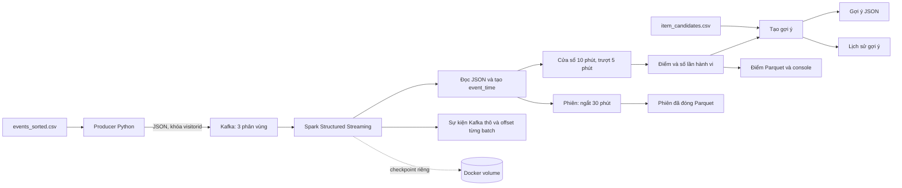

# Luồng dữ liệu và cách pipeline xử lý khi chạy

## 1. Từ CSV đến Kafka

`src/producer.py` giữ `timestamp` gốc tính bằng Unix milliseconds trong JSON. `SPEEDUP` hoặc `RATE` chỉ điều khiển **khi nào** Kafka nhận thông điệp; chúng không sửa thời điểm sự kiện. `SKIP` bỏ qua dòng dữ liệu sau header, `LIMIT` giới hạn số dòng gửi. `REORDER_BUFFER` có thể trộn các nhóm dòng để minh họa sự kiện đến không theo thứ tự.

Producer đặt Kafka key bằng `visitorid`. Với số phân vùng topic không đổi, các thông điệp cùng key được đưa vào cùng phân vùng và có thứ tự trong phân vùng đó; Kafka không tạo thứ tự chung giữa ba phân vùng. Producer bật idempotence cho retry của chính producer, nhưng phát lại CSV trong một lần chạy mới vẫn tạo thông điệp mới.

## 2. Từ Kafka đến cửa sổ điểm

`transform_events` trong `src/streaming_etl.py` phân tích JSON theo `EVENT_SCHEMA`, chuyển milliseconds thành `event_time`, loại bản ghi thiếu `timestamp`/`visitorid`/`itemid`, loại loại sự kiện không biết và giao dịch không có `transactionid`. Spark lấy nguồn Kafka với `startingOffsets=earliest` khi **chưa** có checkpoint và bật `failOnDataLoss=true`. Sau khi checkpoint tồn tại, Spark dùng offsets đã lưu; `MAX_OFFSETS_PER_TRIGGER=0` nghĩa là không áp giới hạn theo cấu hình này.

`score_windows` nhóm theo `(window, visitorid, itemid)`. Mặc định một cửa sổ dài 10 phút và trượt mỗi 5 phút, nên hành vi lúc 12:07 thuộc cả 12:00–12:10 lẫn 12:05–12:15. Điểm bằng `view × 1 + addtocart × 5 + transaction × 10`; ba bộ đếm hành vi được giữ riêng. Truy vấn dùng chế độ `Update` và trigger xử lý mỗi 5 giây, vì vậy các bản tổng hợp thay đổi có thể xuất trước khi cửa sổ đóng.

Watermark mặc định là 5 phút theo **thời gian sự kiện**, được tính từ thời điểm sự kiện lớn nhất Spark đã quan sát trong truy vấn, không phải đồng hồ hiện tại. Watermark mới thường có hiệu lực trong micro-batch tiếp theo để lọc dữ liệu muộn và dọn trạng thái. Khi watermark đi qua cuối một cửa sổ, sự kiện gửi đến sau cho cửa sổ đó có thể bị bỏ qua. Luồng không có sự kiện mới thì watermark không tự tiến. Xem [hướng dẫn Structured Streaming của Spark](https://spark.apache.org/docs/3.5.8/structured-streaming-programming-guide.html) để hiểu chi tiết chế độ Update và watermark.

## 3. Chọn gợi ý và lưu lịch sử

Một dòng cửa sổ được đánh dấu `high_intent` khi điểm đạt `INTENT_THRESHOLD` (mặc định 5). Không yêu cầu thêm giỏ, không kiểm tra transaction hoặc lịch sử mua. Năm view, một addtocart hoặc một transaction đều có thể đạt ngưỡng.

`src/build_candidates.py` tạo bảng ứng viên tĩnh từ hành vi `view`/`addtocart` của cùng khách trong 500.000 dòng đầu CSV. Mỗi sản phẩm có tối đa một ứng viên đồng xem; mã sản phẩm xuất hiện ở phần còn lại của CSV nhưng thiếu quan hệ được gán một sản phẩm phổ biến dự phòng. Compose dùng `--ensure-top-one`: tạo bảng khi thiếu/rỗng hoặc phát hiện nhiều ứng viên trên một sản phẩm; bảng không cập nhật theo từng micro-batch. Khi đổi dữ liệu nguồn, dừng Spark và chạy builder không có cờ này để tạo lại.

Spark nối sản phẩm đang quan tâm với ứng viên top 1 cố định, loại chính sản phẩm đó và gộp trùng giữa các cửa sổ trong batch. Lịch sử `recommendation_history/` chặn cùng bộ ba `(visitorid, interested_itemid, recommended_itemid)` xuyên batch, cửa sổ và session. Không có ứng viên thì không có gợi ý. Bảng nhiều ứng viên trên một item bị từ chối; tạo lại bằng builder trước khi chạy.

Lịch sử gợi ý là các tệp Parquet đọc lại trong callback. Việc ghi chúng, gợi ý JSON và checkpoint Spark không nằm trong một giao dịch chung. Một giao dịch đến sau cũng không thu hồi gợi ý đã xuất trước đó.

## 4. Phiên truy cập

Một truy vấn Spark riêng dùng `session_window(event_time, 30 minutes)` cho từng `visitorid`. Nếu chuỗi hành vi liên tục mà không có khoảng ngắt đủ 30 phút, chúng thuộc cùng phiên. `session_id` là mã băm từ `visitorid` và `session_start`; đây là mã của phiên suy ra, không phải mã khách hàng.

Tệp phiên có `event_count`, số lần từng loại hành vi, `first_event_time`, `last_event_time`, `session_start`, `session_end` và `duration_seconds`. Thời lượng là khoảng cách giữa hành vi đầu và cuối, không bao gồm 30 phút chờ để đóng phiên. Truy vấn dùng chế độ `Append`: chỉ ghi phiên sau khi watermark vượt `session_end`. Vì vậy producer dừng không có nghĩa mọi phiên sẽ xuất hiện ngay. Cửa sổ phiên độc lập với cửa sổ trượt tính điểm.

## 5. Đầu ra và khả năng khôi phục

| Vị trí trong thư mục `OUTPUT_HOST_DIR` | Nội dung |
|---|---|
| `intent/batch_id=...` | Bản cập nhật tổng hợp Parquet, chia thêm theo `event_date`. Muốn lấy trạng thái mới nhất của một khóa cửa sổ cần chọn `batch_id` lớn nhất. |
| `recommendations/batch_id=...` | Gợi ý JSON theo batch. |
| `recommendation_history/batch_id=...` | Các gợi ý đã xuất, dùng để chống lặp. |
| `sessions/batch_id=...` | Các phiên đã đóng, định dạng Parquet. |
| `micro_batches/batch_id=....json` | Số dòng tổng hợp được cập nhật, thời gian callback và thời điểm hoàn thành; không phải số sự kiện Kafka đầu vào. |
| `raw_events/batch_id=...` | Bản ghi Kafka thô dạng Parquet, gồm JSON gốc, trường đã phân tích, partition, offset và batch ID của truy vấn lưu thô. |
| `intent_input_offsets/batch_id=....json` | Khoảng offset và `num_input_rows` của batch tính điểm; dùng để tra đầu vào thực tế. |

Ba truy vấn chính có checkpoint độc lập trong Docker volume: `intent`, `sessions` và `console`. Khi `ARCHIVE_RAW_EVENTS=1`, truy vấn lưu thô thứ tư có checkpoint `raw_events` và đọc Kafka riêng, nên batch ID của nó **không tương ứng** với batch ID của truy vấn điểm. Listener lưu offset bắt đầu/kết thúc của từng batch điểm; `src/inspect_batch.py` dùng các khoảng offset này để tìm bản ghi trong kho thô. Với batch đầu tiên nếu tiến độ Spark không có start offset, công cụ thử đọc offset ban đầu từ checkpoint `intent`. Kafka end offset là cận trên không bao gồm. Các tệp mới chỉ tồn tại sau khi chạy mã mới.

Checkpoint giữ offsets và trạng thái Spark. Ghi đè tệp theo `batch_id` giúp một số lần chạy lại cùng batch ít tạo trùng tệp, nhưng không bảo đảm exactly once cho toàn pipeline. Giữ checkpoint cùng thư mục output tương ứng khi khôi phục; khi đổi lược đồ trạng thái, nên tạo Compose project và output mới. Xem [README](../README.md) để chạy lại từ đầu.

## Ví dụ qua nhiều batch

| Batch | Hành vi trong cùng cửa sổ của V001 với A | Điểm | Kết quả |
|---:|---|---:|---|
| 0 | Xem A | 1 | Chưa đủ điều kiện. |
| 1 | Xem A lần nữa | 2 | Chưa đủ điều kiện. |
| 2 | Thêm A vào giỏ | 7 | Đủ điều kiện nếu có ứng viên và bộ ba chưa có trong lịch sử gợi ý. |
| 3 | Mua A | 17 | Lịch sử gợi ý chặn xuất lại cùng bộ ba; transaction không loại high-intent. |

Mỗi cửa sổ chồng nhau có điểm riêng; bảng ví dụ chỉ mô tả **một** cửa sổ.
