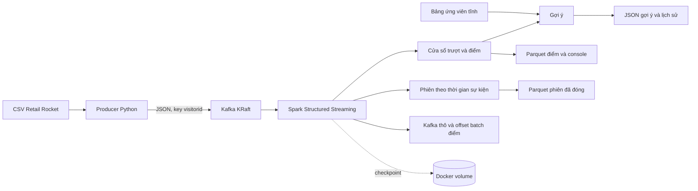

# Theo dõi phiên và gợi ý sản phẩm theo thời gian thực

## 1. Mục tiêu và phạm vi

Dự án dùng dữ liệu Retail Rocket để mô phỏng lại một pipeline xử lý luồng: phát lại hành vi người dùng vào Kafka, tính điểm quan tâm bằng Spark Structured Streaming, đề xuất một sản phẩm liên quan và ghi lại các phiên truy cập. Đây là bản demo cục bộ để học về phân vùng Kafka, micro-batch, thời gian sự kiện, watermark và checkpoint; dự án chưa đánh giá chất lượng gợi ý như một sản phẩm thương mại.

Dữ liệu hiện tại đã loại 460 bản sao giống nhau ở cả năm cột (94 view, 366 addtocart), giữ lần xuất hiện đầu tiên và thứ tự thời gian.

Tệp `data/events_sorted.csv` gồm 2.755.642 dòng tính cả header, tức 2.755.641 sự kiện. Mỗi sự kiện có `timestamp` theo Unix milliseconds, `visitorid`, `event`, `itemid` và `transactionid`. `visitorid` là mã khách truy cập trong bộ dữ liệu; một mã có thể xuất hiện ở nhiều phiên, nhưng không chứng minh được danh tính khách hàng ngoài bộ dữ liệu.

## 2. Đối chiếu yêu cầu với phần triển khai

| Yêu cầu                              | Cách dự án thực hiện                                                                                                                                                                                                                    |
| -------------------------------------- | -------------------------------------------------------------------------------------------------------------------------------------------------------------------------------------------------------------------------------------------- |
| Nguồn sự kiện liên tục            | `src/producer.py` đọc CSV và gửi JSON lên Kafka theo tốc độ có thể điều chỉnh; `SKIP` và `LIMIT` chọn đoạn dữ liệu để phát.                                                                                      |
| Kafka có khả năng xử lý song song | `docker/docker-compose.yml` tạo topic mặc định ba phân vùng trên một Kafka broker KRaft. Key `visitorid` giữ các thông điệp cùng khách trong một phân vùng; số phân vùng giới hạn mức song song khi đọc topic. |
| Đọc Kafka bằng Spark | `src/streaming_etl.py` dùng Kafka source, schema JSON rõ ràng, chuyển `timestamp` sang `event_time` và lọc sự kiện không hợp lệ. |
| Cửa sổ thời gian sự kiện | Mặc định cửa sổ 10 phút trượt 5 phút và watermark 5 phút; cấu hình qua `.env`. |
| Điểm quan tâm và gợi ý | Điểm `view=1`, `addtocart=5`, `transaction=10`. Chỉ cần điểm đạt ngưỡng; tra top 1 trong `data/item_candidates.csv`, không lọc mua hàng và chống lặp bằng lịch sử gợi ý. |
| Nhận diện phiên | Truy vấn riêng dùng khoảng không hoạt động 30 phút cho từng `visitorid`, ghi số hành vi và thời điểm đầu/cuối phiên khi watermark cho phép đóng. |
| Đầu ra, log và khôi phục | Ghi Parquet, JSON, số liệu batch và console; ba truy vấn chính có checkpoint độc lập. Có manifest offset; bật `ARCHIVE_RAW_EVENTS=1` để chạy thêm truy vấn lưu Kafka thô. |
| Hướng dẫn và kiểm tra | `README.md` hướng dẫn chạy; `tests/test_streaming_etl.py` kiểm tra phân tích JSON và logic điểm cơ bản. |

## 3. Kiến trúc và luồng dữ liệu

Producer giữ nguyên thời điểm lịch sử trong JSON dù phát lại ở thời điểm hiện tại. Spark đọc Kafka độc lập; khi không có checkpoint, `STARTING_OFFSETS=earliest` cho phép đọc từ đầu các thông điệp topic còn lưu. Sau khi có checkpoint, Spark tiếp tục từ offsets trong checkpoint.

Truy vấn điểm chạy ở chế độ `Update` với trigger mặc định 5 giây. Parquet chứa nhiều **bản cập nhật** theo `batch_id`, không phải một bảng kết quả cuối đã gộp. Muốn lấy điểm mới nhất cho `(window_start, window_end, visitorid, itemid)` cần chọn bản có `batch_id` lớn nhất. Giao dịch đóng góp 10 điểm như trước; lịch sử gợi ý, không phải lịch sử mua, ngăn xuất lại cùng bộ ba.

Truy vấn phiên chạy ở chế độ `Append`. `session_id` được suy ra từ `visitorid` và đầu phiên; cùng khách có thể có nhiều `session_id`. Thời điểm đóng phiên phụ thuộc watermark theo thời gian sự kiện, không phụ thuộc riêng vào lúc producer dừng. Xem [mô tả pipeline](PIPELINE_FLOW.md) để biết chi tiết từng bước và đầu ra.

## 4. Cơ sở kỹ thuật

### DStreams và Structured Streaming

Spark Streaming kiểu cũ biểu diễn dữ liệu thành chuỗi RDD micro-batch (DStreams). Structured Streaming cho phép mô tả luồng như bảng không giới hạn với DataFrame/SQL; Spark thực thi truy vấn tăng dần, quản lý phép tổng hợp có trạng thái, watermark và checkpoint. Dự án dùng chế độ micro-batch để có `foreachBatch` và các cửa sổ thời gian sự kiện. Theo [hướng dẫn Structured Streaming của Apache Spark](https://spark.apache.org/docs/3.5.8/structured-streaming-programming-guide.html), `foreachBatch` dựa trên cơ chế micro-batch, còn session window không hỗ trợ chế độ Update, nên truy vấn phiên ở đây dùng Append.

### ETL, thời gian sự kiện và khôi phục

Bước trích xuất đọc bytes từ Kafka; bước biến đổi phân tích JSON theo kiểu dữ liệu rõ ràng, lọc bản ghi lỗi, tạo `event_time` và điểm; bước nạp ghi kết quả, lịch sử gợi ý và số liệu xử lý. Lọc trước phép tổng hợp giúp trạng thái chỉ chứa sự kiện hợp lệ. Các biểu thức Spark SQL được dùng thay cho Python UDF cho phép Spark tối ưu kế hoạch thực thi.

Watermark mặc định 5 phút giới hạn độ trễ sự kiện mà truy vấn có thể chấp nhận và giúp dọn trạng thái cửa sổ. Watermark mới có thể chỉ tác động ở batch sau; luồng đứng yên không tự đẩy watermark. Cửa sổ 10 phút trượt mỗi 5 phút nên một sự kiện có thể đóng góp vào hai cửa sổ. Điểm `view=1`, `addtocart=5`, `transaction=10` là quy tắc của bài tập, chưa phải kết quả học từ dữ liệu.

Checkpoint Spark lưu tiến độ Kafka và trạng thái truy vấn. Kafka giữ sự kiện nguồn để Spark có thể đọc lại khi cần; dự án không dùng receiver DStream hay write-ahead log của receiver. Với `foreachBatch`, việc ghi nhiều thư mục Parquet/JSON và tiến checkpoint không nằm trong cùng giao dịch. Tệp theo `batch_id` giúp ghi đè một lần thử lại cùng batch, nhưng không tạo bảo đảm exactly once xuyên suốt.

### Ứng viên và chất lượng gợi ý

`src/build_candidates.py` lấy những sản phẩm cùng được một `visitorid` xem hoặc thêm vào giỏ trong 500.000 dòng đầu để tạo cặp đồng xem, một ứng viên tốt nhất cho mỗi sản phẩm có quan hệ. Nó quét toàn CSV lấy các mã sản phẩm và gán phương án dự phòng theo độ phổ biến của phần đầu cho sản phẩm thiếu quan hệ. Bảng này tĩnh, không cập nhật trực tuyến.

Trong mỗi batch, Spark tra một ứng viên cố định và loại bộ ba đã xuất trong lịch sử gợi ý; không xét mua hàng. Quy tắc chỉ xét điểm là lựa chọn nghiệp vụ mới, khác điều kiện thêm giỏ/chưa mua của đề bài gốc. Chưa có tập kiểm tra tách theo thời gian hay chỉ số đánh giá gợi ý. Nếu xây ứng viên từ dữ liệu tương lai so với thời điểm muốn đánh giá, kết quả sẽ bị rò rỉ thông tin.

### Vì sao chọn Kafka thay vì Flume

| Tiêu chí            | Kafka trong dự án                                                              | Flume                                                                                                            |
| --------------------- | -------------------------------------------------------------------------------- | ---------------------------------------------------------------------------------------------------------------- |
| Mô hình             | Log sự kiện lưu theo topic và phân vùng; producer và consumer tách rời. | Luồng thu thập dựa trên agent với source, channel và sink.                                                 |
| Đọc lại            | Spark có thể đọc lại offsets còn trong thời hạn lưu trữ của topic.    | Channel chủ yếu làm bộ đệm chuyển sự kiện, không phục vụ cùng kiểu đọc lại log nhiều consumer. |
| Song song             | Phân vùng chia tải; thứ tự được bảo đảm trong từng phân vùng.      | Chia tải theo cấu hình các agent/channel/sink.                                                               |
| Tích hợp với Spark | Có Kafka source và connector chuyên dụng.                                    | Thường cần thêm đường chuyển dữ liệu hoặc hệ trung gian.                                             |
| Vận hành            | Cần quản lý broker, topic, retention và phân vùng.                         | Phù hợp hơn với bài toán thu thập/chuyển tiếp log.                                                      |

Kafka dùng KRaft để quản lý metadata thay cho ZooKeeper. Cấu hình trong dự án chỉ có một broker/controller và replication factor 1, nên không có tính sẵn sàng cao. Xem [tài liệu Kafka](https://kafka.apache.org/documentation/) và [tài liệu tích hợp Spark–Kafka](https://spark.apache.org/docs/3.5.8/structured-streaming-kafka-integration.html).

### Gợi ý tối ưu ETL

Khảo cứu của Ali và Wrembel về thiết kế và tối ưu luồng ETL mô tả tác động của thứ tự và cách hiện thực các bước xử lý đến chi phí thực thi. Áp dụng ở mức demo: phân tích schema một lần, lọc sớm, chỉ giữ cột cần thiết, dùng biểu thức SQL, giới hạn trạng thái bằng watermark và chia tệp đầu ra theo ngày/batch. Đây là định hướng thiết kế; dự án chưa có benchmark để khẳng định cải thiện hiệu năng. Số liệu `duration_ms` chỉ đo thời gian callback `write_batch`, không phải độ trễ đầu cuối. Xem [bài báo Ali và Wrembel](https://link.springer.com/article/10.1007/s00778-017-0477-2).

## 5. Chạy và trình bày

Thực hiện các lệnh trong [README](../README.md). Với ví dụ 1.000 sự kiện đầu, đặt `SO_DONG=1000` trong `.env` rồi chạy `sh scripts/demo.sh start`; có thể đặt thêm `SPEEDUP=0`, `RATE=10` nếu muốn tốc độ cố định 10 sự kiện/giây. Trong buổi demo, có thể lần lượt mở Kafka UI tại cổng `8085`, xem log producer/Spark, gợi ý JSON, điểm Parquet, phiên Parquet và checkpoint. Các sự kiện trong 1.000 dòng đầu trải gần 59 phút theo thời gian sự kiện nên một số phiên sớm có thể đóng khi watermark tiến lên. Xem [kịch bản demo](DEMO_SCENARIOS.md) để biết kết quả mong đợi và cách tránh nhầm lẫn giữa mong đợi với đã kiểm chứng.

## 6. Hạn chế và hướng mở rộng

- Một broker và Spark `local[2]` phù hợp demo, chưa chịu được lỗi broker hoặc mở rộng như cụm production.
- Producer không lưu checkpoint vị trí CSV; phát lại cùng đoạn sẽ tạo sự kiện trùng. `SKIP` phải được đặt thủ công.
- Lịch sử gợi ý được đọc lại từ Parquet ở mỗi batch; chi phí tăng theo số batch. Gợi ý đã xuất không được thu hồi khi sự kiện mua đến muộn.
- Ba checkpoint chính và checkpoint tùy chọn của truy vấn lưu thô nằm trong Docker volume cục bộ. Thay đổi lược đồ trạng thái cần kế hoạch di chuyển hoặc một lần chạy mới. Lưu thô cần thêm dung lượng và lượt đọc Kafka; batch ID của truy vấn này khác batch ID của truy vấn điểm.
- `visitorid` chưa được nối với tài khoản, thiết bị hay sự đồng ý của người dùng; chất lượng gợi ý chưa được đánh giá trên dữ liệu tương lai.

Các bước tiếp theo là bổ sung mã sự kiện và cơ chế chống trùng, thay lịch sử tệp bằng state store/kho lưu trữ phù hợp, đánh giá gợi ý bằng phân chia dữ liệu theo thời gian, giám sát độ trễ và thử triển khai đa nút.

## Tài liệu tham khảo

1. M. Armbrust và cộng sự, “Structured Streaming: A Declarative API for Real-Time Applications in Apache Spark”, SIGMOD 2018. [Bài báo](https://people.eecs.berkeley.edu/~alig/papers/structuredstreaming.pdf).
2. Apache Spark, [Hướng dẫn Structured Streaming](https://spark.apache.org/docs/3.5.8/structured-streaming-programming-guide.html), nhánh 3.5.
3. Apache Spark, [Hướng dẫn tích hợp Structured Streaming và Kafka](https://spark.apache.org/docs/3.5.8/structured-streaming-kafka-integration.html), nhánh 3.5.
4. Apache Kafka, [Tài liệu Kafka](https://kafka.apache.org/documentation/).
5. S. M. F. Ali và R. Wrembel, “From conceptual design to performance optimization of ETL workflows: current state of research and open problems”, *The VLDB Journal*, 2017. [Bài báo](https://link.springer.com/article/10.1007/s00778-017-0477-2).
